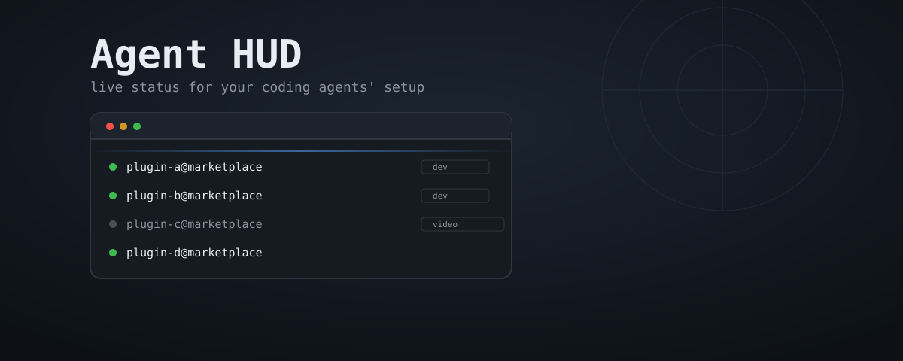
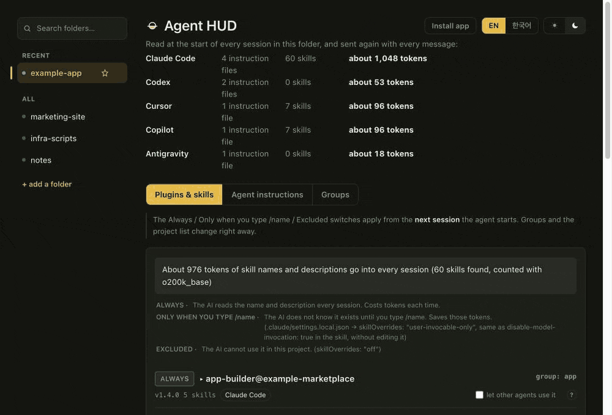
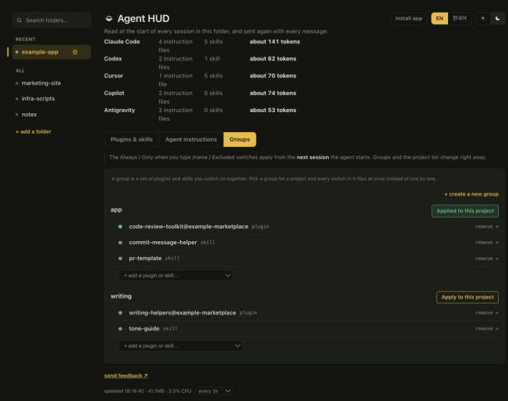
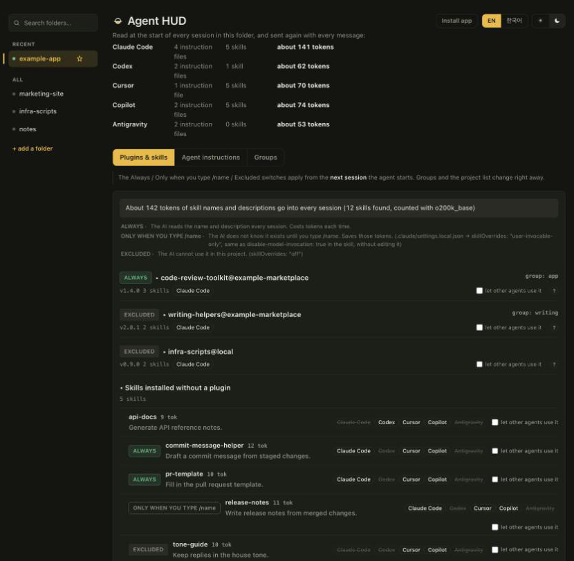
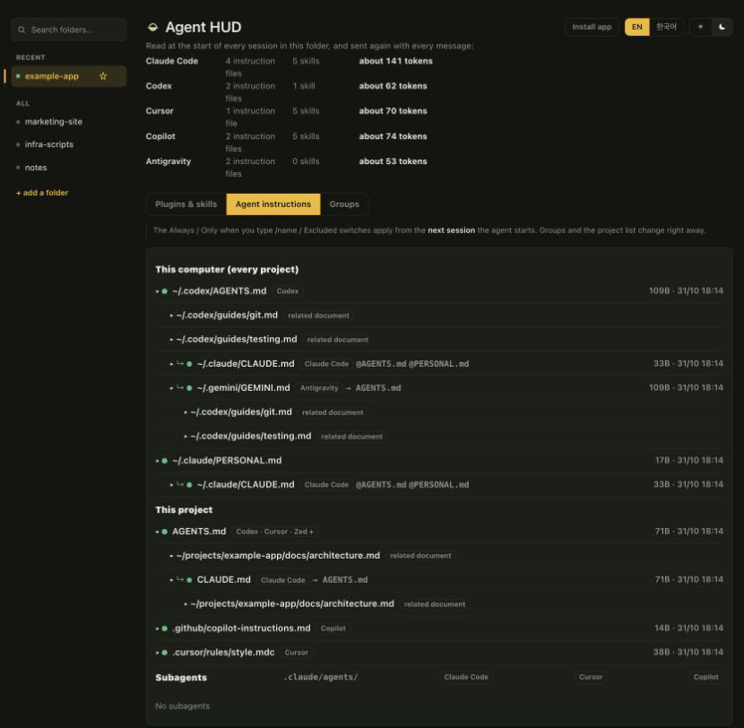

<p align="center">
  <a href="README.md"></a>
  <a href="README.ko.md"></a>
</p>

<p align="center"><b>한국어 설명은 위의 <a href="README.ko.md">한국어</a> 버튼을 누르세요.</b></p>

<p align="center">
  
</p>

<p align="center">A local dashboard for your coding agents' skills, instructions, and plugin state.</p>

<p align="center">
  <a href="https://ganggangstone.github.io/agent-hud/">Website</a> ·
  <a href="../../releases">Releases</a> ·
  <a href="../../issues">Issues</a>
</p>

<p align="center">
  
</p>

Coding agents load the names and descriptions of available skills into the context at
the start of a session. Descriptions of skills the session never uses waste input tokens. On the developer's
machine, the names and descriptions of 60 skills totaled 18,938 characters, an estimated
5,000–9,000 tokens. `claude plugin disable <plugin> -s local` turns a plugin off for one
project, but only one plugin at a time, and nothing shows how many skills are still loaded.

Agent HUD shows how many skills each project loads, and lets you save the plugins and
skills you use together as a group and apply a different group to each project.

## Quickstart (macOS)

If you use an AI coding agent, it can do the whole install for you. Paste this into
Claude Code, Codex, or whichever agent you use:

> Install Agent HUD from https://github.com/ganggangstone/agent-hud. Follow the "For AI agents" section of its README.

To do it yourself:

1. Install it with Homebrew. This puts an Agent HUD app in Applications and installs the
   `agent-hud` command.

   ```bash
   brew install --cask ganggangstone/tap/agent-hud-app
   ```

2. Open **Agent HUD** from Launchpad or Applications. The dashboard opens in your browser at
   <http://127.0.0.1:41717>. Add the project folder you work in with "+ add a folder" in the
   sidebar. If you use Claude Code, paste the hook setting the installer prints into
   `~/.claude/settings.json` and you can skip this: each folder you open a session in is
   added for you. Agent HUD does not search your disk for projects. The sidebar lists only
   folders added one of these two ways, so projects you opened before adding the hook need
   "+ add a folder" once.
3. In the Groups tab, create a group and click "Apply to this project".

## Install

The command above installs two Homebrew packages: the `agent-hud` formula (the dashboard
and its command) and the `agent-hud-app` cask (an app icon that runs `agent-hud open`).
If you only want the command:

```bash
brew install ganggangstone/tap/agent-hud
brew services start agent-hud
```

Without Homebrew, clone the repository and run the install script:

```bash
git clone https://github.com/ganggangstone/agent-hud.git agent-hud && cd agent-hud
./install.sh
```

The install script copies `server.py` to `~/.claude/tools/agent-hud/`, creates
and registers a `launchd` service, so the dashboard
keeps running after you close terminals and restarts if the process exits. Homebrew
installs an `agent-hud` command and runs the same server with `brew services`.

## For AI agents

Steps for an agent asked to install, open, or update Agent HUD on the user's Mac.

1. **Install.** If `brew` is available, run
   `brew install --cask ganggangstone/tap/agent-hud-app && brew services start agent-hud`.
   The first installs the dashboard, its command and an app icon; the second keeps it running
   from login and opens it in the browser. Otherwise clone this repository (for example to `~/agent-hud`) and run `./install.sh` in it.
2. **Register sessions (Claude Code only).** Add a `SessionStart` hook to
   `~/.claude/settings.json`. Merge it into any hooks already there; do not replace them.
   The command is `nohup agent-hud --register "$PWD" >/dev/null 2>&1 & disown` for a Homebrew
   install, or `nohup python3 "$HOME/.claude/tools/agent-hud/server.py" --register "$PWD" >/dev/null 2>&1 & disown`
   for a cloned one.
3. **Open.** `agent-hud open` for a Homebrew install, or `open http://127.0.0.1:41717`.
   With the cask installed, tell the user they can reopen it any time from **Agent HUD** in
   Launchpad.
4. **Update.** Follow [Updating](#updating). For a cloned install you need the clone's folder;
   if you did not install it yourself, ask the user where it is. Tell the user which version
   was installed before and after.

## What it shows

<p align="center">
  
  
  
</p>

- **Groups**: lists of plugins and skills you use together. Applying a group to a project
  links the group's skills into that project's skill folders and turns on its plugins and
  skills. Every other plugin, and every skill outside a plugin, is turned off for Claude
  Code. Other projects are not changed.
- **Plugins & skills**: every installed skill, listed by plugin, with a badge for each
  agent that can read it in the selected project. Plugins, and skills that aren't part of
  a plugin, have a switch for Claude Code. For skills outside a plugin it has three
  positions: ON, MANUAL (hidden from Claude until you type `/name`) and OFF. A skill whose
  `SKILL.md` sets `disable-model-invocation: true` shows MANUAL and can't be changed here.
- **Reference token counts**: next to each skill, and as a total for every skill Agent HUD
  found plus a total per agent. See [Token counts](#token-counts).
- **Header**: for the selected project, what each agent reads at the start of every session
  and sends again with every message: how many instruction files, how many skills, and about
  how many tokens the two add up to. Instruction files are counted in full; skills by name and
  description. Only files read at session start count (the user-level and project-root files,
  plus what `CLAUDE.md` imports), not `CLAUDE.md` files in subfolders.
- **Agent instructions**: 31 kinds of instruction files in the project, such as
  `CLAUDE.md`, `AGENTS.md` and `.cursor/rules/`, with their size and modified time,
  plus the user-level `~/.claude/CLAUDE.md`, `~/.codex/AGENTS.md` and `~/.gemini/GEMINI.md`.
  Files that read another file are nested under it, with the actual `@path` line or symlink
  arrow shown next to the name, so you can see at a glance which files share one source and
  which stand alone and can drift. Agent HUD does not decide which file is the source of truth; one way to set that up
  is in [How do you keep instruction files in sync?](https://medium.com/@adventuresol/how-do-you-keep-instruction-files-agents-md-and-claude-md-in-sync-c335873b3966).

## Token counts

The Plugins & skills tab counts the tokens in each skill's name and description: the text
`name`, a line break, then `description` from `SKILL.md`, counted with the `o200k_base`
tokenizer. The skill body is not counted. These are reference counts made on your computer,
not any provider's own count or bill, and they do not say how many skills a session loaded.

- Every skill found is counted once, including plugins that are switched off and skills
  only Codex, Cursor, Copilot, Gemini CLI or Antigravity can see. A skill in two folders is
  one skill.
- The per-agent figures count the skills each agent can see with the current settings, and
  add up the tokens of those that could be counted. Switching a plugin off, or a skill off in `skillOverrides`, removes it from Claude Code's
  total only; another agent that reads the skill through a link keeps it.
- A skill whose name or description is missing, can't be read, or whose `---` frontmatter is
  not closed shows `tok n/a` and is left out of the token sum, instead of counting its folder
  name as if it were the description. It still counts as a skill found and visible. When
  some skills are left out, the line reads "Measured subtotal ... N of M skills, not a full
  total" and the affected agents read "17 measured (3 of 4)"; with none counted it says
  "Not measured" rather than 0.

The dashboard itself needs nothing beyond Python. Counting uses the `tiktoken` package,
which you install once into a private folder next to `server.py` (or in `AGENT_HUD_HOME`):

```bash
agent-hud tokens setup                    # Homebrew
python3 server.py tokens setup            # a clone, from the clone's folder
```

This creates `tokenizer-venv/` and `tokenizer-cache/`, installs `tiktoken` from PyPI into
that venv with the Python that runs the command, and downloads the public `o200k_base`
vocabulary file once. Nothing global is installed and no skill text leaves your computer.
After that, counting runs offline. Until it is set up the tab says the count is not
measured and shows this command; it never shows an estimate. `./install.sh` runs the
setup too and carries on if it fails, and so does the dashboard's Update now button on a
Homebrew install when the counter is missing. If no `tiktoken` build exists for your newest Python,
run the command with an older one, for example `python3.13 server.py tokens setup`: if
`tokenizer-venv/` was made by another Python version, setup rebuilds it with the Python that
runs the command (only a folder that is already a venv is replaced; any other content stops
setup with an error).

## Concepts

| Concept | Belongs to |
|---|---|
| [Skill](#skill) | Every agent that follows the Agent Skills standard |
| [Instruction file](#instruction-file) | Each agent, with its own file name |
| [Plugin](#plugin) | Claude Code |
| [Group](#group) | Agent HUD |

### Skill

A folder with a `SKILL.md` file, following the [Agent Skills](https://agentskills.io)
standard. The six agents read the same format but look in different folders: in a
project, Claude Code reads `.claude/skills/`, Codex, Gemini CLI and Antigravity read
`.agents/skills/`, and Cursor and Copilot read both. Agent HUD links the skill into both
folders instead of copying it, so an agent reads the same copy whichever folder it looks in.
Following the link was checked with Claude Code, Codex, Gemini CLI, Copilot and Antigravity,
not yet with Cursor.

A skill that isn't part of a plugin, whether in `~/.claude/skills/` or in the project, can
be switched off, or set to manual-only, per project. Agent HUD writes `skillOverrides`
(`off` or `user-invocable-only`) into the project's `.claude/settings.local.json`, which
only Claude Code reads. Manual-only keeps the skill in the `/` menu but out of the model's
context until you call it, the same effect as `disable-model-invocation: true` in the
skill's frontmatter, without editing the skill.

A skill inside a plugin is read only by Claude Code, while that plugin is on. The checkbox
on the Plugins & skills tab links it into the project's skill folders, so the other agents
read it too, and Claude Code reads it even with the plugin off.

### Instruction file

A markdown rules file an agent reads every session: `CLAUDE.md` for Claude Code,
`AGENTS.md` for Codex, Cursor and others, `.cursor/rules/` for Cursor,
`.github/copilot-instructions.md` for Copilot. Agent HUD lists these files and never
edits them.

### Plugin

A bundle of skills, subagents, commands and hooks, installed with
`claude plugin install`. The ON/OFF switch in Agent HUD writes `enabledPlugins` into the
selected project's `.claude/settings.local.json`, so other projects are not affected.

### Group

A named list of plugins and skills you use together, such as "writing" or "video
editing". Groups exist only in Agent HUD and are stored in `modes.json`.

A group can hold plugin skills, skills in your user skill folders (`~/.claude/skills`,
`~/.agents/skills` and so on), and skills that live inside one of the projects in the
sidebar. For the last kind, other projects get a link to that project's folder, so moving or
deleting that project breaks the link. When two skills share a name, a plugin skill wins
over a user skill, and a user skill over a project one.

## Setting up groups

1. In the Groups tab, click "+ create a new group".
2. Enter a name and choose the first plugin to add.
3. Add more plugins and skills from "+ add a plugin or skill…" under the group.
4. Pick a project in the sidebar, then click "Apply to this project" in the Groups tab.

### Which agents it applies to

The group's skills are linked into the project skill folders used by the supported agents.
Agent HUD's ON/OFF switches update Claude Code settings only. It does not manage other
agents' individual skill activation settings. Changing groups also adds or removes
project skill links, which can change the skills other agents discover.

| | In the group | Not in the group |
|---|---|---|
| Claude Code | On | Plugins and skills outside a plugin are turned off |
| Codex, Gemini CLI, Antigravity, Cursor, Copilot | Skills are read | Not turned off |

If you use more than one agent, keep your skills in `~/.claude/skills` and link them with
groups. Codex, Gemini CLI and Antigravity then read a skill only in the projects a group
linked it into, and Claude Code can switch it per project. A skill in `~/.agents/skills` is
read by Codex and Gemini CLI in every project. Cursor and Copilot read both folders
everywhere, so they can't be split per project.

The same from a terminal (`agent-hud` instead of `python3 …/server.py` if you installed
with Homebrew):

```bash
python3 ~/.claude/tools/agent-hud/server.py groups          # list groups
python3 ~/.claude/tools/agent-hud/server.py apply dev       # apply "dev" to the current folder
python3 ~/.claude/tools/agent-hud/server.py apply --off     # remove the group's skill links and restore plugin and skill settings from before it was applied
```

You can also edit `modes.json` directly. A value written as a single list is a group with
plugins only.

```json
{
  "dev": {
    "plugins": ["some-plugin@some-marketplace"],
    "skills": ["some-skill"]
  },
  "video": ["video-tools@local"]
}
```

Plugin names must match the names on the Plugins & skills tab, including the
`@marketplace` part. A skill name is the skill's folder name. The dashboard picks up the
saved file on its next refresh, so you don't need to restart anything.

## Behavior across projects and sessions

One server runs on the computer and every project uses it. Opening or closing terminals
does not restart the server or change its port.

In **Plugins & skills**, expand **Worktrees in this repository** to see checkouts of
the same Git repository. Select skills, directories and worktrees, preview the paths,
then add missing skills. Existing directories, broken links and links to a different
source are kept and reported. This shares skill files only; it does not copy plugin
hooks, agents, MCP configuration or settings, or apply a group’s plugin switches.
Subfolder configurations cannot be applied to the whole repository through this control.

**Save and enable for new worktrees** stores the selected skill sources as the repository
default. While HUD is running, it checks for new worktrees every 15 seconds and adds only
missing links. Existing worktrees are unchanged when you enable or update the default;
select them for manual application. Each worktree can use the default, be excluded, or
save a separate selection. Disabling automatic application preserves existing links.
Sources are pinned to the paths you selected; moving/deleting a source or replacing a
plugin cache version is reported rather than silently choosing a same-named skill.
Removed worktrees are disabled. Paths under `/Volumes` are left unchecked.

The first agent session may start before the background check finishes. If you need the
files in place before launch, run `agent-hud worktrees apply` inside that checkout,
using the same HUD data directory as the dashboard. It applies the saved default or
custom selection and respects exclusions; it does not start or restart an agent.
`agent-hud worktrees` prints the file states without applying anything.

File states do not prove what an existing session can use. [Codex](https://learn.chatgpt.com/docs/build-skills)
detects skill changes automatically; check `/skills`, and restart only if updates do not
appear. [Claude Code](https://code.claude.com/docs/en/skills#edit-a-skill-during-a-session)
may need `/reload-skills` if the top-level directory did not exist when the session began.
On Claude Code 2.1.277 and later, a worktree without its own `.claude/skills` can read the
main checkout’s skills. Creating that directory stops the fallback, so choose only
`.agents/skills` to share with Codex alone. These session behaviors follow the official
documentation; this change was tested with temporary Git worktrees and HTTP/browser
requests, not live Codex or Claude sessions.

## Managing the service

```bash
launchctl list | grep agent-hud                               # check it is running
launchctl kickstart -k gui/$(id -u)/com.agent-hud             # restart
launchctl bootout gui/$(id -u) ~/Library/LaunchAgents/com.agent-hud.plist  # stop until next login
tail -f ~/.claude/tools/agent-hud/launchd.err.log             # view logs
```

With Homebrew, use `brew services restart agent-hud` and `brew services stop agent-hud`;
logs are in `$(brew --prefix)/var/log/agent-hud.err.log`. `agent-hud open` opens the
dashboard in your browser, starting it first if it is not running.

The dashboard always uses port 41717, so bookmarks and the installed app keep working. If
another program already uses that port, the dashboard waits for it to be free instead of
moving to another number, and says so in the log.

If `CLAUDE_HUD_DISABLE=1` is set before a session's hook runs, that session neither starts
a server nor registers its project, and `groups` and `apply` do nothing. A server that is
already running keeps running.

## Open it as an app

Click **Install app** in the header to get a window without browser chrome and with its
own icon. Chrome and Edge install it in one step. In other browsers,
including Safari, it tells you which menu to use instead (Safari on macOS Sonoma or later: File → Add to Dock).

## Updating

Once a day the dashboard checks GitHub Releases for a new version and shows a notice at
the top of the page when there is one.

- **Homebrew:** click **Update now** in the notice. The dashboard runs `brew update` and
  `brew upgrade agent-hud`, restarts itself on the new code, and the page reloads. From a
  terminal: `brew update && brew upgrade agent-hud && brew services restart agent-hud`.
- **Cloned:** click **Copy a request for your AI agent** and paste it into your agent, or
  run `git pull` in the clone and then `./install.sh`. The service runs the copy in
  `~/.claude/tools/agent-hud/`, so `git pull` alone changes nothing; `./install.sh` copies
  the new file and restarts the service.

The daily check is the only request the dashboard makes on its own. It downloads an update
only when you click **Update now**, and Homebrew does the downloading. Agent HUD reads and
writes settings files on this computer only and needs no account.

## Known limitations

What works and what does not for each agent, and the rules for agents operating HUD, are in [docs/GUIDE.md](docs/GUIDE.md).

- **macOS only.** The installer and app are built for macOS. On Linux, run `server.py`
  directly and configure a service manager such as `systemd --user` separately.
  macOS features such as the Finder folder picker are unavailable. Windows is not
  supported yet ([#1](../../issues/1)).
- **Plugin changes take effect from the next session.** Claude Code reads plugin state
  when a session starts.
- **You can't hide one skill of a plugin.** A `permissions.deny` entry stops the skill
  from being invoked, but its name and description still load every session, so it
  saves no tokens ([docs/ADR.md](docs/ADR.md) section 10). Turning the whole plugin off
  is the only way.

## Feedback and contributing

Report bugs and suggestions in [Issues](../../issues), in English or Korean. The "send
feedback ↗" link at the bottom of the dashboard opens an issue form with the version
already filled in. To run it from a checkout, run the checks, or add a panel, see
[CONTRIBUTING.md](CONTRIBUTING.md). Design decisions and the alternatives behind them
are in [docs/ADR.md](docs/ADR.md).

## License

MIT. See [LICENSE](LICENSE).
